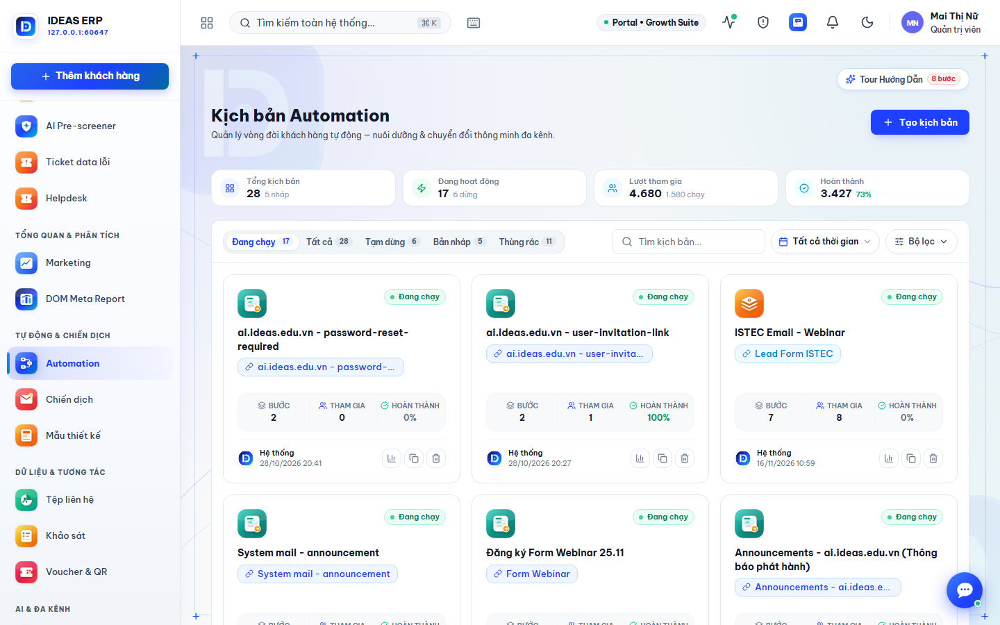
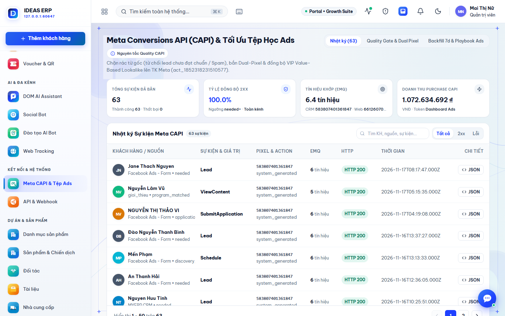

# Local UI/UX Screenshot Comparison & Automated Audit Summary

- **Plan ID**: `PLAN-M4-UIUX-COMPARE-001`
- **Generated At**: `2026-11-21T06:16:33.726Z` (Duration: `38.0s`)
- **Overall Status**: **PASS** (Captured: `2/2`, Capture Errors: `0`)
- **Audit Checks**: Pass=`15` | Fail=`0` | Skip=`9` | Total=`24`
- **Mode / Viewports**: `erp` / `1440x900, 390x844` (Strict: `false`, Mock Meta: `true`)
- **Browser**: `C:\Program Files\Google\Chrome\Application\chrome.exe`
- **Origins**: Backend=`http://127.0.0.1:60646` | ERP=`http://127.0.0.1:60647` | Landing=`n/a`

## 1. Automated Audit Checks Summary (12 Checks)

| Check ID | Category | Pass | Fail | Skip | Status |
|---|---|---:|---:|---:|---|
| `runtime_clean` | Console & Network | 2 | 0 | 0 | **PASS** |
| `route_guard_clean` | Auth & ErrorBoundary | 2 | 0 | 0 | **PASS** |
| `splash_landing_bg` | Loading Screen (08:36Z) | 0 | 0 | 2 | **SKIP** |
| `dom_svg_decor_present` | Architectural Decor (08:36Z) | 2 | 0 | 0 | **PASS** |
| `typography_be_vietnam_pro` | Typography | 2 | 0 | 0 | **PASS** |
| `palette_sapphire_red_no_purple` | Palette (09:10Z) | 2 | 0 | 0 | **PASS** |
| `sidebar_light_animated_clean` | White Sidebar (09:10Z) | 2 | 0 | 0 | **PASS** |
| `settings_upgrade_relocated` | Settings Upgrade (09:10Z) | 0 | 0 | 2 | **SKIP** |
| `standard_app_icons` | AppIcons (09:10Z) | 0 | 0 | 2 | **SKIP** |
| `date_range_filter_present` | Date Filter (09:10Z) | 1 | 0 | 1 | **PASS** |
| `modal_zns_drawer_tour_contracts` | R3 Components | 0 | 0 | 2 | **SKIP** |
| `viewport_no_horizontal_overflow` | Layout Stability | 2 | 0 | 0 | **PASS** |

## 4. Group C — Dual-Mode Marketing Pages: Portal (`C*p`) vs Standalone (`C*s`) (`1440x900`)

| Pair | Viewport | Route | Portal (`domation_promax`) | Standalone (`marketing_standalone`) |
|---|---|---|---|---|
| **C02** | `1440x900` | `/marketing/flows` | **PASS (8)**  [`1440x900/C02p-portal-flows-list.png`](1440x900/C02p-portal-flows-list.png) | _not run_ |
| **C12** | `1440x900` | `/marketing/capi vs /capi` | **PASS (7)**  [`1440x900/C12p-portal-capi.png`](1440x900/C12p-portal-capi.png) | _not run_ |

## 7. Automated Audit Failures & Diagnostics

Zero automated audit failures recorded across all executed captures.
